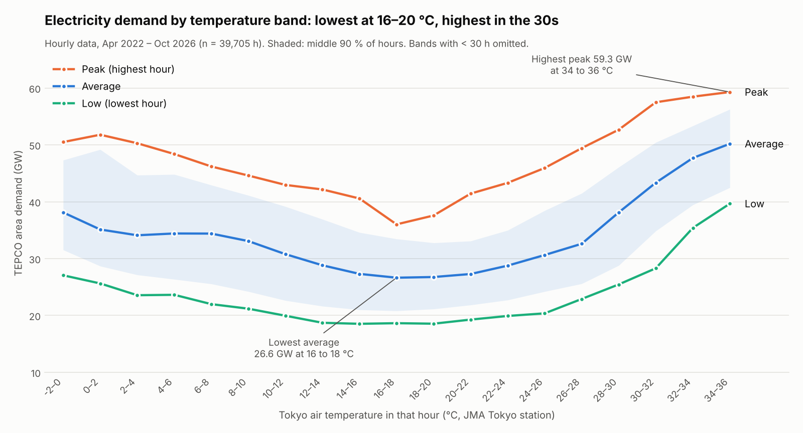

# Task 01: Clean & Prepare a Dataset (Tokyo electricity demand × JMA temperature)

This project cleans and prepares real hourly electricity-demand data for the Tokyo area, together with weather observations from the Japan Meteorological Agency (JMA, 気象庁). It then answers one question: **at which temperatures is demand at its peak, and at which is it lowest?**

## Key findings



- **Lowest demand: 16–20 °C.** At these temperatures, homes and offices need neither heating nor cooling. Average demand falls to **26.6 GW**, and the lowest single hour was 18.5 GW, at 06:00 on 4 May 2025 during Golden Week (15.9 °C).
- **Peak demand: 34–36 °C.** Air-conditioning pushes average demand to **50.2 GW**, about **1.9×** the mild-weather level. The all-time hour in the data was **59.3 GW** at 13:00 on 2 Aug 2022, when Tokyo was 34.9 °C.
- **Cold raises demand too, but less than heat.** The winter peak was 51.8 GW in the 0–2 °C band.
- **Days off sit about 4–8 GW lower** than workdays at the same temperature (see the second chart).

| Tokyo temp (°C) | Hours | Low (GW) | Average (GW) | Peak (GW) |
|---|---:|---:|---:|---:|
| −2 to 0 | 70 | 27.1 | 38.1 | 50.5 |
| 0 to 2 | 406 | 25.6 | 35.1 | 51.8 |
| 4 to 6 | 2,101 | 23.6 | 34.4 | 48.4 |
| 8 to 10 | 2,442 | 21.2 | 33.1 | 44.6 |
| 12 to 14 | 2,605 | 18.7 | 28.8 | 42.2 |
| **16 to 18** | 2,858 | 18.6 | **26.6** | **36.0** |
| **18 to 20** | 2,971 | 18.5 | 26.8 | 37.6 |
| 22 to 24 | 3,035 | 19.9 | 28.8 | 43.3 |
| 26 to 28 | 3,363 | 22.9 | 32.6 | 49.4 |
| 30 to 32 | 1,363 | 28.3 | 43.4 | 57.5 |
| **34 to 36** | 351 | 39.7 | **50.2** | **59.3** |

The table above is a selection. Every 2 °C band, a workday-only version and the daily figures are in [`reports/report.md`](reports/report.md).


## Data

| | Source | Content |
|---|---|---|
| Electricity | TEPCO Power Grid, "でんき予報" past usage data | Hourly Tokyo-area demand, TEPCO's forecast, supply capacity, usage rate, solar output (万kW = 10 MW) |
| Weather | Japan Meteorological Agency, "過去の気象データ・ダウンロード", hourly values | Temperature, relative humidity and sunshine for Tokyo, Yokohama, Chiba, Kumagaya, Mito, Utsunomiya, Maebashi and Kofu, plus a population-weighted Kanto mean |

The data covers 2022-04-01 00:00 to 2026-10-12 23:00 JST: 39,744 hours.

The two official downloads were joined into one hourly file by the open-source project [kaseee/tokyo-grid-lab](https://github.com/kaseee/tokyo-grid-lab), at commit `19c86a3`. That file is used here as `data/raw/`. Data © TEPCO Power Grid and the Japan Meteorological Agency (processed).

Because that project had already tidied the data, it was cleaner than a typical raw download. Every check below was still run, and the results are reported as they came out.

## Results: before vs after

| Check                                                    |       Before |          After |
|:---------------------------------------------------------|-------------:|---------------:|
| Rows (hours)                                             |       39,744 |         39,744 |
| Missing measurement cells                                |          229 |            225 |
| Hours missing from the timeline                          |            0 |              0 |
| Duplicate timestamps / duplicate rows                    |        0 / 0 |          0 / 0 |
| Values outside physical limits                           |            0 |              0 |
| Hours where TEPCO's two demand figures disagree by > 3 % (unflagged) |            8 |              0 |
| Timestamp type                                           |         text | datetime (Asia/Tokyo) |
| Power unit                                               | 万kW (10 MW) |             GW |
| Analysis columns (temp band, hour, holiday, workday)     |            0 |              4 |
| Memory in pandas (MB)                                    |        11.57 |           6.32 |

## What was done

| Requirement | How it was handled |
|---|---|
| **Load** | Read the CSV with pandas and inspected its types. The timestamp column was plain text. |
| **Identify missing values** | Checked for blank cells (229, all in humidity columns plus 2 temperature hours at Maebashi) **and** for missing hours in the timeline (0). Measured the length of each gap: the humidity gaps are station outages lasting 1–3 days. |
| **Handle missing values** | The data was re-indexed to a complete hourly timeline. Gaps of 3 hours or less were filled by time interpolation and flagged in `<column>_imputed`. Longer humidity outages were left blank on purpose, because filling 3 days of humidity would invent data. Demand and Tokyo temperature, the columns used in the analysis, are 100% complete. |
| **Duplicates** | Checked both duplicate rows and duplicate timestamps: none were found. The removal step stays in the pipeline so it remains safe if new months are added. |
| **Incorrect / inconsistent values** | Range checks against physical limits for temperature, humidity, sunshine and demand found 0 problems. Consistency checks also found 0: usage rate equals demand ÷ supply, demand never exceeds supply, and solar output is 0 at night. **8 hours** where TEPCO's hourly demand differs by more than 3% from the average of its own 5-minute readings (cold snaps on 2025-01-23 and 2026-02-09) are flagged in `demand_source_mismatch`. **2 sudden temperature drops** of more than 6 °C in an hour were compared with a neighbouring station. Both were real summer thunderstorms, so they were kept, not deleted. |
| **Data types & units** | Timestamps converted from text to timezone-aware datetimes (Asia/Tokyo). Power converted from 万kW to **GW**, and columns renamed with their units (`_gw`, `_c`, `_pct`, `_h`). Measurements stored as float32, usage rate as Int16 and flags as bool. Season, weekday and temperature band are ordered categories. |
| **Prepare for analysis** | Added Japanese holidays (national holidays plus New Year and Obon), a workday flag, hour, month, season and **2 °C temperature bands**. Also built a daily table of peak demand, low demand and temperatures. |
| **Export** | `data/clean/tokyo_hourly_clean.csv`, `.parquet` (keeps the data types), `tokyo_daily_peak_low.csv` and `schema.json`. |

## Project structure

```
tokyo-demand-temperature/
├── data/
│   ├── raw/tokyo_hourly_demand_weather_raw.csv.gz
│   └── clean/  tokyo_hourly_clean.csv · tokyo_hourly_clean.parquet · tokyo_daily_peak_low.csv · schema.json
├── notebooks/01_clean_tokyo_demand_temperature.ipynb   # step-by-step walkthrough, executed
├── src/
│   ├── clean_prepare.py      # load → profile → clean → prepare → export
│   └── analysis.py           # temperature-band analysis, charts, report
├── reports/
│   ├── report.md             # findings, all band tables, before/after, cleaning log
│   ├── demand_by_temp_band_hourly.csv · demand_by_temp_band_workdays.csv · daily_peak_low_by_temp_band.csv
│   ├── quality_metrics.json · cleaning_log.csv · key_findings.json
│   └── figures/
└── requirements.txt
```

## How to run

```bash
pip install -r requirements.txt
python src/analysis.py      # cleans the data, then writes the analysis, charts and report
```

```python
import pandas as pd
df = pd.read_parquet("data/clean/tokyo_hourly_clean.parquet")
df.groupby("temp_band", observed=True)["demand_gw"].agg(["mean", "max", "min"])
```

## Limitations

- Hot hours are mostly afternoons, and cold hours are mostly mornings and evenings. Part of each band's demand level therefore reflects the time of day, not just the temperature.
- Bands with fewer than 30 hours (below −2 °C and above 36 °C) are marked `thin_sample` and left out of the chart.
- Temperatures come from the single JMA Tokyo station (Kitanomaru Park). The file also includes a Kanto-wide average, `temp_kanto_c`, for comparison.
